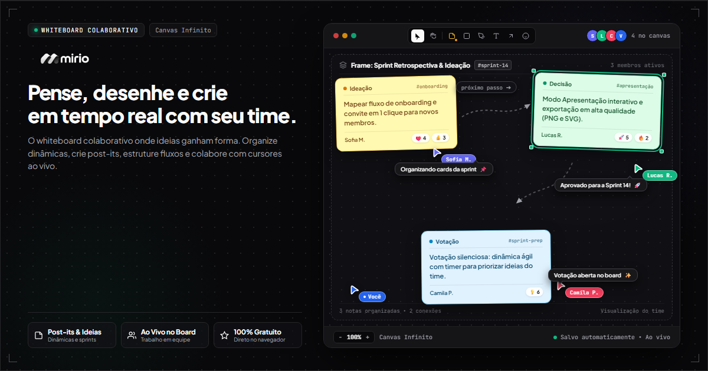

<div align="center">


<br />
<br />

**O whiteboard colaborativo em tempo real, fluido e sem fricção para equipes modernas.**

Pense, desenhe, faça ideações e facilite dinâmicas com a agilidade do Miro e a leveza que seu time precisa.

<br />

[](https://react.dev/)
[](https://www.typescriptlang.org/)
[](https://vitejs.dev/)
[](https://tailwindcss.com/)
[](https://firebase.google.com/)
[](./LICENSE)

<br />



</div>

<br />

---

## ✨ Por que o Mirio?

O **Mirio** foi concebido para eliminar barreiras entre uma ideia e sua execução. Sem interfaces sobrecarregadas ou barreiras de acesso: compartilhe um link e comece a colaborar em segundos.

### 🚀 Destaques da Experiência

- **⚡ Entrada Sem Burocracia**: Participe em 1 clique como convidado ou conecte-se com sua conta Google.
- **🎨 Canvas Infinito & Fluido**: Motor gráfico em Konva.js com zoom suave, navegação a 60 FPS e suporte a telas Retina.
- **📝 Post-its Inteligentes**: Notas adesivas com paleta pensada para contraste, hiperlinks clicáveis e tipografia moderna.
- **✅ Micro-Widgets Vivos**: Checklists táteis em tempo real com barra de progresso comemorativa, feedback sonoro e conversão instantânea de post-its.
- **🔷 Formas Geométricas & Desenho Livre**: Retângulos, círculos, triângulos, losangos, estrelas, conectores direcionais e caneta com suavização.
- **💬 Cursor Chat & Interações Vivas**: Pressione `/` e converse diretamente pela posição do seu mouse (estilo Figma), aponte com feixe Laser (`L`) e envie reações flutuantes.
- **⏱️ Facilitação Profissional**: Cronômetro colaborativo sincronizado na sala e sessões de votação anônima com pódio automático.
- **📋 Templates Prontos para Sprint**: Crie com um clique quadros para *Lean Canvas*, *Retrospectivas*, *Brainstorming* e *Matriz de Priorização*.
- **🔒 Segurança & Controle**: Quadros protegidos por senha opcional, modo apresentação para slides e permissões granulares por participante.
- **🌗 Design System Imersivo**: Tema Claro e Escuro com transições suaves e zero oscilação visual (Zero-FOUC).

---

## 🎯 Principais Recursos

<table>
  <tr>
    <td width="50%">
      <h3>🖌️ Criação e Diagramação</h3>
      <ul>
        <li><strong>Post-its Clássicos</strong>: Edição rápida com duplo clique e auto-dimensionamento.</li>
        <li><strong>Formas Vetoriais</strong>: Redimensione segurando <code>Shift</code> para proporção perfeita.</li>
        <li><strong>Conectores Direcionais</strong>: Setas e linhas magnéticas para fluxogramas.</li>
        <li><strong>Molduras (Frames)</strong>: Agrupe conteúdos e monte apresentações em sequência.</li>
        <li><strong>Stickers & Apple Emojis</strong>: Dê expressividade e contexto visual às discussões.</li>
      </ul>
    </td>
    <td width="50%">
      <h3>🤝 Colaboração em Equipe</h3>
      <ul>
        <li><strong>Cursores ao Vivo</strong>: Acompanhe os movimentos de cada colega em tempo real.</li>
        <li><strong>Cursor Chat</strong>: Bate-papo instantâneo sobre a tela.</li>
        <li><strong>Apontador Laser</strong>: Destaque pontos na tela sem sujar o canvas.</li>
        <li><strong>Sessões de Votação</strong>: Votos limitados e apuração transparente para tomadas de decisão.</li>
        <li><strong>Timer Compartilhado</strong>: Mantenha reuniões e dinâmicas no tempo certo.</li>
      </ul>
    </td>
  </tr>
</table>

---

## ⌨️ Atalhos Rápidos

Ganhe velocidade dominando os atalhos do teclado:

| Tecla | Função |
| :---: | :--- |
| <kbd>V</kbd> | Ferramenta Seleção / Mover |
| <kbd>Espaço</kbd> ou <kbd>H</kbd> | Arrastar a Tela (Pan) |
| <kbd>N</kbd> | Criar Post-it |
| <kbd>C</kbd> | Criar Checklist Interativo (Micro-Widget) |
| <kbd>R</kbd> | Retângulo |
| <kbd>O</kbd> | Círculo |
| <kbd>T</kbd> | Caixa de Texto |
| <kbd>P</kbd> | Caneta de Desenho Livre |
| <kbd>L</kbd> | Apontador Laser temporário |
| <kbd>/</kbd> | Abrir Cursor Chat |
| <kbd>F</kbd> | Criar Moldura / Frame |
| <kbd>Delete</kbd> | Excluir seleção |
| <kbd>Ctrl</kbd> + <kbd>Z</kbd> | Desfazer ação |

> 💡 *Você também pode pressionar <kbd>?</kbd> a qualquer momento no quadro para ver a lista completa de atalhos.*

---

## 🚀 Como Executar

### Pré-requisitos
- [Node.js](https://nodejs.org/) (versão 18 ou superior)
- Gerenciador de pacotes `npm`

### Instalação

1. **Clone o repositório:**
   ```bash
   git clone https://github.com/ialexanderbrito/whiteboard.git
   cd whiteboard
   ```

2. **Instale as dependências:**
   ```bash
   npm install
   ```

3. **Inicie o ambiente de desenvolvimento:**
   ```bash
   npm run dev
   ```

Acesse [http://localhost:5173](http://localhost:5173) no seu navegador.

> ℹ️ *Por padrão, o projeto inclui um modo de demonstração local automático. Para habilitar sincronização multiusuário na nuvem, basta configurar as credenciais do Firebase no arquivo `.env` seguindo o `.env.example`.*

---

## 🛠️ Tecnologias Utilizadas

- **Interface & Componentes**: [React 19](https://react.dev/), [TypeScript](https://www.typescriptlang.org/), [Tailwind CSS](https://tailwindcss.com/), [shadcn/ui](https://ui.shadcn.com/)
- **Renderização Gráfica**: [Konva.js](https://konvajs.org/) e [React Konva](https://github.com/konvajs/react-konva)
- **Tempo Real & Nuvem**: [Firebase](https://firebase.google.com/) (Firestore + Realtime Database)
- **Ícones & Emojis**: [Lucide React](https://lucide.dev/), Emojis em alta resolução
- **Build & Qualidade**: [Vite](https://vitejs.dev/), Node Test Runner

---

## 📄 Licença

Este projeto é distribuído sob os termos da licença [MIT](./LICENSE).

<br />

<div align="center">
  <sub>Criado com dedicação para colaboração visual em tempo real.</sub>
</div>
